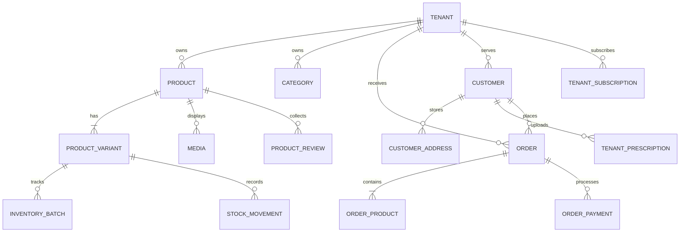

<p align="center">
  
</p>

<h1 align="center">Genzilla SaaS — Multi-Tenant Pharmacy & E-Commerce Cloud Platform</h1>

<p align="center">
  An enterprise-grade, multi-tenant Software-as-a-Service (SaaS) platform built for online pharmacies and digital healthcare e-commerce. Engineered with Laravel 12, Inertia.js v2, Vue 3, and Tailwind CSS v4.
</p>

<p align="center">
  
  
  
  
  
  
  
  
</p>

---

## 📋 Table of Contents

- [Executive Summary](#-executive-summary)
- [System Architecture](#-system-architecture)
- [Key Features](#-key-features)
- [Tech Stack & Ecosystem](#-tech-stack--ecosystem)
- [Data Models & Schema](#-data-models--schema)
- [Project Directory Structure](#-project-directory-structure)
- [Getting Started & Installation](#-getting-started--installation)
- [Local Subdomain & Multi-Tenancy Setup](#-local-subdomain--multi-tenancy-setup)
- [Default Seeded Credentials](#-default-seeded-credentials)
- [Testing & Quality Assurance](#-testing--quality-assurance)
- [License](#-license)

---

## 🌟 Executive Summary

**Genzilla** is a high-performance multi-tenant SaaS architecture designed to power independent digital pharmacies and health storefronts under isolated subdomains or custom domains. The platform features an end-to-end ecosystem:

1. **Platform SuperAdmin Panel:** Centralized oversight for tenant provisioning, recurring subscription tiers, billing cycles, automated usage quotas, and marketing CMS.
2. **Tenant Store Admin:** Dedicated dashboard for pharmacy merchants to manage inventory batches, expiry tracking, order fulfillment, prescription verification, pricing rules, and staff RBAC.
3. **High-Converting Customer Storefront:** A reactive Single-Page Application (SPA) driven by Inertia.js and Vue 3 featuring instant live search, faceted catalog filtering, detailed product showcases with variant pricing, mobile sticky buy bars, and complete customer account portals.

---

## 🏛 System Architecture

The application adopts a **Single-Database, Shared-Schema Multi-Tenancy Architecture** with strict tenant segregation enforced at the routing and ORM levels.

```
                              ┌────────────────────────────────────────┐
                              │           Incoming HTTP Request        │
                              └───────────────────┬────────────────────┘
                                                  │
                                                  ▼
                              ┌────────────────────────────────────────┐
                              │      IdentifyTenant Middleware         │
                              │  - Resolves Subdomain (tenant.domain)  │
                              │  - OR Resolves Custom Domain           │
                              └───────────────────┬────────────────────┘
                                                  │
                         ┌────────────────────────┴────────────────────────┐
                         │                                                 │
                         ▼                                                 ▼
        ┌──────────────────────────────────┐             ┌──────────────────────────────────┐
        │        Platform Portal           │             │        Tenant Storefront         │
        │  - SaaS Landing / Pricing / Blog │             │  - Dynamic Catalog & Live Search │
        │  - Platform SuperAdmin Panel     │             │  - Prescription Uploads (Rx)     │
        │  - Subscription & Tenant Billing │             │  - Customer Dashboard & Cart     │
        └──────────────────────────────────┘             └──────────────────────────────────┘
                         │                                                 │
                         ▼                                                 ▼
        ┌───────────────────────────────────────────────────────────────────────────────────┐
        │                              Laravel 12 Service Layer                             │
        │           Tenant Scoping Helpers (tenant(), tenantID()), Spatie Multi-Team RBAC   │
        └─────────────────────────────────────────┬─────────────────────────────────────────┘
                                                  │
                                                  ▼
        ┌───────────────────────────────────────────────────────────────────────────────────┐
        │                        MySQL Database & Tenant File Storage                       │
        │             Single Database with `tenant_id` Foreign Key Constraints              │
        │              Isolated Asset Folders: `/storage/tenants/{tenant_id}/...`           │
        └───────────────────────────────────────────────────────────────────────────────────┘
```

### Architectural Highlights
- **Subdomain & Custom Domain Routing:** Incoming requests are inspected by `IdentifyTenant.php`. Subdomains (e.g. `medicare.platform.test`) or registered custom domains are automatically resolved to a `Tenant` model and bound to the application container.
- **Tenant Isolation & Security:** All tenant-scoped models (`Product`, `Order`, `Customer`, `Category`, `TenantPrescription`, etc.) are partitioned by `tenant_id`. Helper functions `tenant()` and `tenantID()` guarantee safe tenant access across controllers and jobs.
- **Inertia.js Hybrid Rendering:** Zero-API-overhead architecture. Server-side Laravel routing delivers props directly into reactive Vue 3 components without exposing public boilerplate endpoints.
- **Multi-Guard Authentication:**
  - `web` guard for Platform SuperAdmins and Store Owners.
  - `customer` guard for tenant-specific storefront shoppers.
- **Tenancy-Aware RBAC:** Powered by `spatie/laravel-permission` with team permissions enabled (`teams => true`), allowing granular permissions scoped per store.

---

## 🚀 Key Features

### 🛒 1. Modern Storefront & Customer Portal
- **Interactive Live Search (`SearchListing.vue`):** Real-time debounce search dropdown with keyboard navigation (`↑`/`↓`/`Enter`), generic medicine lookup, thumbnail caching, and zero-state suggestions.
- **Faceted Search Results (`SearchResults.vue`):** Comprehensive filtering by categories, brands, price range sliders, star ratings, and OTC vs. Rx prescription requirements.
- **Dynamic Product Details (`ProductDetails.vue`):**
  - High-resolution interactive media gallery with thumbnail switching.
  - Variant/pack-size selection with instant price, discount, and inventory recalculation.
  - Quantity stepper, Add to Cart flyout drawer, and one-click "Buy Now" checkout modal.
  - Tabbed scientific disclosures: Description, Dosage Guidelines, Active Ingredients, Customer Reviews, and Pharmacist FAQs.
  - Sticky mobile buy bar with real-time total pricing.
- **Prescription Upload & Compliance:** Patients can upload digital prescriptions directly during checkout or via their customer dashboard for pharmacist verification before dispensing.
- **Customer Self-Service Dashboard:** Profile avatar upload with fallback initials, multi-address management, prescription status tracking, past orders, and wishlists.

### 🏪 2. Tenant Store Management (Store Admin)
- **Batch Inventory Tracking (`InventoryBatch`):** Track stock per batch with manufacturer lot numbers, purchase costs, and expiry dates.
- **Stock Movements Audit (`StockMovement`):** Complete ledger of stock adjustments, orders, returns, and write-offs.
- **Product Catalog Management:** Products with multiple variants (`ProductVariant`), attributes, polymorphic media (`Media`), and soft-delete protection.
- **Order Management & Invoicing:** Processing states (pending, processing, shipped, delivered, cancelled), payment transaction records (`OrderPayment`), and downloadable PDF invoices via DomPDF.
- **Promotions & Logistics:** Coupon code discount engine, delivery charge tiers by district/city, promotional sliders, and homepage banner placements.

### 🌐 3. Platform Administration & SaaS Engine
- **Tenant Provisioning:** Instant tenant workspace onboarding with automated role assignment and sample catalog seeding.
- **Subscription Management:** Monthly/annual subscription plans with defined tenant quotas (products, staff seats, storage limits).
- **Invoicing & Billing Audit:** Tenant invoice tracking (`TenantInvoice`) and usage metering (`TenantUsage`).
- **Platform Marketing CMS:** Dynamic landing page sections (Hero, Feature Matrices, Pricing Comparisons, Client Testimonials, Tech Specs, and Blog).

---

## 💻 Tech Stack & Ecosystem

### Backend
| Technology | Version | Purpose |
| :--- | :--- | :--- |
| **PHP** | `^8.2` | Core backend programming language |
| **Laravel** | `12.x` | Enterprise MVC application framework |
| **Inertia Laravel** | `^2.0` | Server-driven adapter for Vue 3 SPA |
| **Laravel Sanctum** | `^4.0` | Secure API token authentication |
| **Spatie Permission** | `^6.25` | Role-Based Access Control (RBAC) with team multi-tenancy |
| **Laravel DomPDF** | `^3.1` | Automated PDF invoice and prescription report generation |
| **Yajra DataTables** | `^12.7` | High-volume server-side paginated tables |

### Frontend
| Technology | Version | Purpose |
| :--- | :--- | :--- |
| **Vue.js** | `^3.4` | Reactive component framework (`<script setup>` Composition API) |
| **Inertia.js** | `^2.0` | Client-side routing and reactive prop synchronization |
| **Tailwind CSS** | `^4.0` | Utility-first responsive styling system |
| **Vite** | `^7.0` | Next-generation fast frontend bundler |
| **Axios** | `^1.11` | Client-side HTTP requests |
| **Swiper** | `^14.3` | Mobile-optimized touch sliders and carousels |

---

## 🗄 Data Models & Schema

The database architecture consists of 45+ relational Eloquent models structured across 5 primary domains:



### Core Model Reference

#### 1. Multi-Tenancy & Subscriptions
- `Tenant`: Core store entity with subdomain, custom domain, branding, support info, and status.
- `TenantDomain`: Custom domain verification and routing mapping.
- `TenantSubscription`: Active plan lifecycle, billing period, and status (`trialing`, `active`, `past_due`).
- `PlatformPlan`: SaaS pricing plans, features, and resource limitations.
- `TenantInvoice` & `TenantUsage`: Subscription invoice ledger and metric quotas.

#### 2. Catalog & Inventory
- `Product`: Base merchandise record (name, slug, description, generic name, prescription requirement flag, specs JSON).
- `ProductVariant`: SKU, pricing, MRP, cost price, and default variant flags.
- `InventoryBatch`: Warehouse batch tracking with expiry dates and physical stock quantities.
- `StockMovement`: Immutable audit trail for stock additions, sales deductions, and adjustments.
- `Category` & `Brand`: Hierarchical catalog classification with position sorting and icon/image associations.
- `Media`: Polymorphic media attachment handling covers, thumbnails, and sliders.

#### 3. Orders & Commerce
- `Order`: Central order entity with invoice ID, customer link, fulfillment status, and total calculation.
- `OrderProduct`: Snapshot of purchased products, variant details, batch references, and line pricing.
- `OrderPayment`: Payment gateway logs, transaction reference, amount, and payment status.
- `Cart` & `CartItem`: Persistent customer shopping cart sessions.
- `Coupon`: Coupon engine with percentage/fixed discounts, minimum order constraints, and validity windows.
- `DeliveryCharge`: Geographic shipping fee tiers.

#### 4. Customer & Pharmacy Compliance
- `Customer`: Storefront customer user with phone authentication and hashed credentials.
- `CustomerAddress`: Address book entries (billing and delivery destinations) with default flags.
- `TenantPrescription`: Prescription document uploads, approval statuses (`pending`, `verified`, `rejected`), and order associations.
- `ProductReview`: Verified purchase ratings (1–5 stars), customer commentary, and merchant replies.

---

## 📁 Project Directory Structure

```text
├── app/
│   ├── Helpers/                      # Global helpers (tenantID, assertSlugAvailable)
│   ├── Http/
│   │   ├── Controllers/
│   │   │   ├── Admin/                # Platform SuperAdmin controllers
│   │   │   ├── Store/                # Tenant Storefront & Store Admin controllers
│   │   │   │   ├── StoreWebviewController.php       # Storefront pages & catalog
│   │   │   │   └── StoreCustomerAuthController.php  # Customer auth & dashboard APIs
│   │   │   └── Auth/                 # Authentication controllers (Breeze/Sanctum)
│   │   └── Middleware/
│   │       ├── IdentifyTenant.php    # Subdomain & custom domain tenant resolver
│   │       ├── HandleInertiaRequests.php # Shared Inertia props (store, auth, customer)
│   │       └── CheckStoreStatus.php  # Store maintenance / suspension checks
│   └── Models/                       # Eloquent models (45+ domain entities)
├── database/
│   ├── migrations/                   # Schema migrations with foreign key constraints
│   └── seeders/                      # Comprehensive demo & production seeders
├── resources/
│   ├── js/
│   │   ├── Components/
│   │   │   └── store/                # Storefront components (Header, ProductCard, SearchListing...)
│   │   ├── composables/
│   │   │   └── store/                # Reactive state stores (useCart, useStoreUi)
│   │   ├── Layouts/                  # StoreLayout, PlatformLayout, AuthenticatedLayout
│   │   └── Pages/
│   │       └── store/                # Inertia Views (home, ProductDetails, SearchResults, Dashboard...)
│   └── views/
│       └── app.blade.php             # Master HTML template initializing Inertia
├── routes/
│   ├── platform.php                  # Public marketing & SaaS landing routes
│   ├── platform_admin.php            # Platform SuperAdmin routes
│   ├── storefront.php                # Tenant storefront & customer portal routes
│   ├── store_admin.php               # Tenant merchant administrative routes
│   └── web.php                       # Root route aggregator
└── vite.config.js                    # Vite 7 build configuration with Tailwind v4
```

---

## ⚙️ Getting Started & Installation

### Prerequisites
Ensure your local development environment meets the following specifications:
- **PHP** >= 8.2 with extensions: `pdo_mysql`, `mbstring`, `openssl`, `gd`, `fileinfo`, `xml`
- **Composer** >= 2.x
- **Node.js** >= 18.x & **npm** >= 9.x
- **MySQL** >= 8.0 or MariaDB >= 10.4

### 1. Clone the Repository
```bash
git clone https://github.com/your-username/genzilla_v3-multitenant-SaaS.git
cd genzilla_v3-multitenant-SaaS
```

### 2. Install Dependencies
```bash
# Install PHP Composer dependencies
composer install

# Install Frontend NPM packages
npm install
```

### 3. Configure Environment
Copy the example environment file and configure your database settings:
```bash
cp .env.example .env
php artisan key:generate
```

Edit `.env` with your local database credentials:
```env
APP_NAME="Genzilla"
APP_ENV=local
APP_DEBUG=true
APP_URL=http://platform.test
BASE_DOMAIN=platform.test

DB_CONNECTION=mysql
DB_HOST=127.0.0.1
DB_PORT=3306
DB_DATABASE=genzilla_v3
DB_USERNAME=root
DB_PASSWORD=
```

### 4. Run Migrations & Seeders
Execute database migrations along with the built-in seeders to populate demo platform plans, tenant storefronts, product catalogs, and review data:
```bash
php artisan migrate:fresh --seed
```

### 5. Link Storage Directory
```bash
php artisan storage:link
```

### 6. Build & Launch Frontend Assets
```bash
# Development mode with Hot Module Replacement (HMR)
npm run dev

# Or compile production bundles
npm run build
```

### 7. Start the Local Server
```bash
php artisan serve --host=0.0.0.0 --port=8000
```

---

## 🌐 Local Subdomain & Multi-Tenancy Setup

To access the platform and tenant storefronts locally, map the root domain and tenant subdomains in your operating system's `hosts` file.

### 1. Update Windows `hosts` or Unix `/etc/hosts`
Add the following entries:
```text
127.0.0.1 platform.test
127.0.0.1 medicare.platform.test
```

### 2. Available Local Endpoints
- **Platform SaaS Landing:** [http://platform.test:8000](http://platform.test:8000)
- **Tenant Storefront:** [http://medicare.platform.test:8000](http://medicare.platform.test:8000)
- **Storefront Live Search:** [http://medicare.platform.test:8000/search](http://medicare.platform.test:8000/search)
- **Customer Dashboard:** [http://medicare.platform.test:8000/dashboard](http://medicare.platform.test:8000/dashboard)

---

## 🔑 Default Seeded Credentials

After running `php artisan migrate --seed`, the database is preloaded with testing credentials:

| Role | Portal / Scope | Email | Password | Phone / Access |
| :--- | :--- | :--- | :--- | :--- |
| **Platform SuperAdmin** | Platform Admin Panel | `admin@genzilla.com` | `password` | Global Platform Access |
| **Store Owner** | Tenant Store Admin | `john@medicarepharma.com` | `password` | MediCare Pharmacy Merchant |
| **Verified Customer** | Storefront Customer | `sarah.jenkins@example.com` | `password` | `+8801711223344` (or OTP Login) |

---

## 🧪 Testing & Quality Assurance

The codebase includes automated test suites and linting routines:

```bash
# Run Pest / PHPUnit test suites
php artisan test

# Verify PHP syntax across controllers and models
php artisan route:list
php -l routes/storefront.php

# Code styling via Laravel Pint
composer pint

# Validate Vite bundle compilation
npm run build
```

---

## 🛡 Security & Best Practices

- **Strict Tenant Boundary:** Every query touching tenant data is constrained by `tenant_id` to prevent cross-tenant data leakage.
- **CSRF & XSS Protection:** Built-in token verification on all POST/PUT/DELETE actions and automated template escaping via Vue 3.
- **Secure File Ingestion:** Strict MIME-type validation and storage path isolation for uploaded customer medical prescriptions and avatar images.
- **Optimized Assets:** Production assets are tree-shaken and gzipped via Vite 7, delivering initial page loads under 1 second.

---

## 📄 License

This software is open-sourced under the [MIT license](LICENSE).
