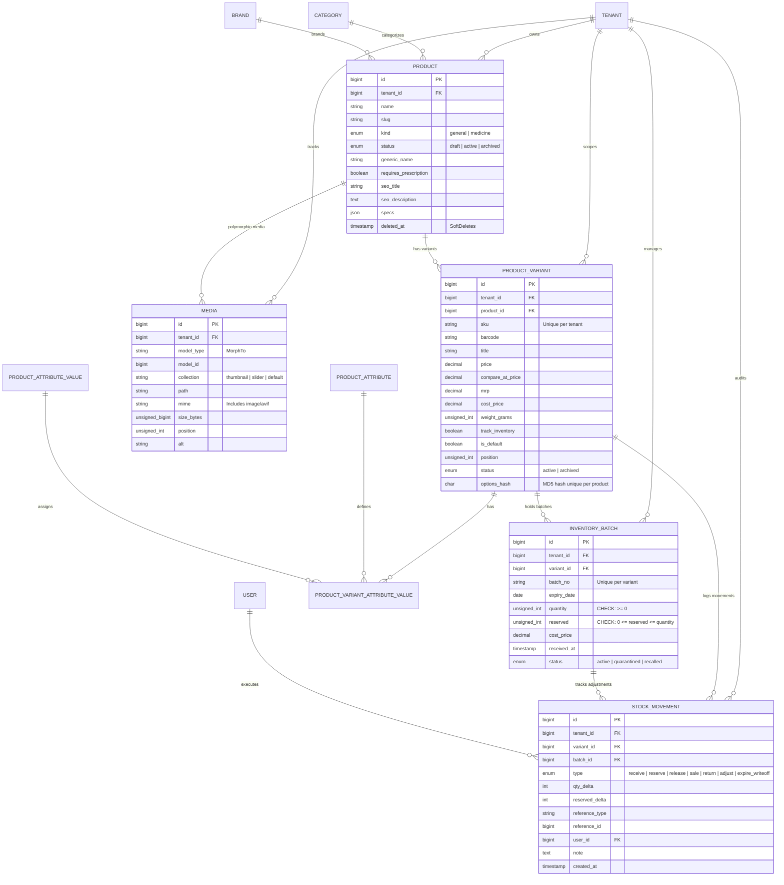
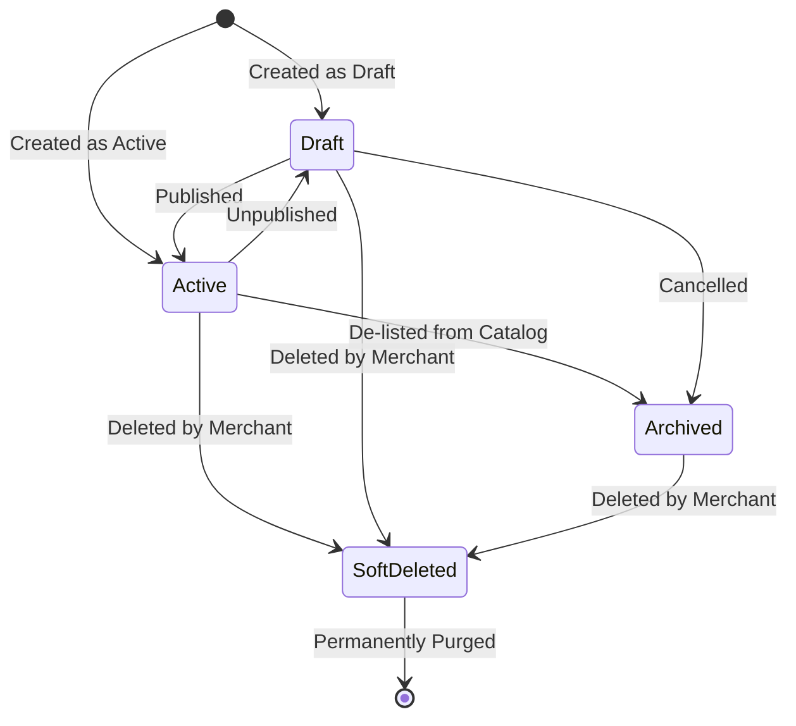
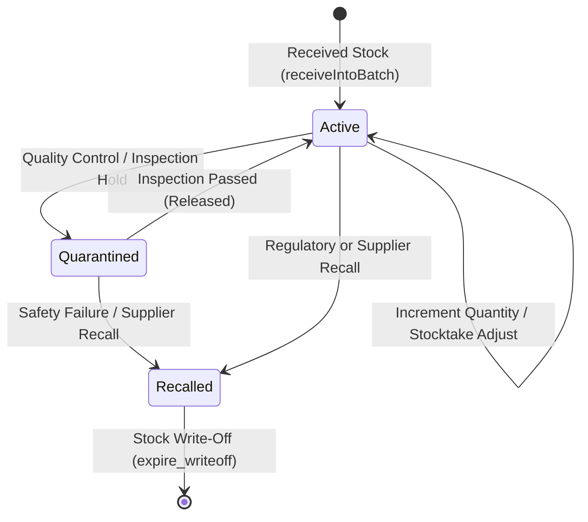
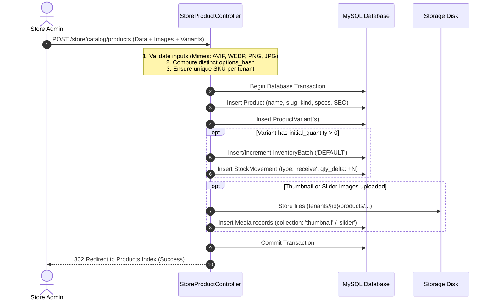
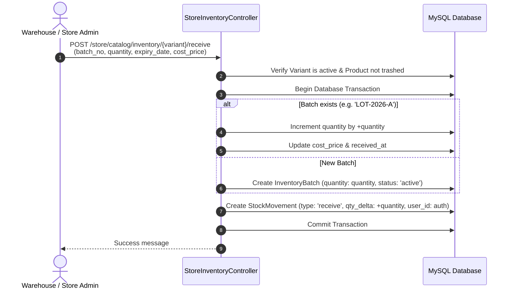

# Product & Inventory Architectural Design & Lifecycle Guide

## 1. Architectural Philosophy & Core Tenets

The Genzilla v3 Multi-Tenant SaaS Product & Inventory system is built upon four fundamental principles:

1. **Strict Multi-Tenant Isolation**:
   Every database table (`products`, `product_variants`, `inventory_batches`, `stock_movements`, `media`) is scoped by `tenant_id`. Queries and mutations are restricted to the tenant boundary via `tenantId()` helpers, Eloquent scopes, and compound database unique keys (e.g. `['tenant_id', 'sku']`).

2. **Catalog vs. Inventory Separation of Concerns**:
   - **Catalog Domain (`Product`, `ProductVariant`)**: Defines marketing descriptions, SEO metadata, categories, brands, specifications, pricing tiers, and presentation media (thumbnails, gallery sliders).
   - **Inventory Domain (`InventoryBatch`, `StockMovement`)**: Maintains physical stock tracking, warehouse lot/batch numbers, expiration dates, cost accounting, stock reservations, and quarantine statuses.

3. **Double-Entry Stock Ledger (Movement Audit Trail)**:
   Inventory quantities are never silently mutated. Every addition, reservation, deduction, or adjustment writes an immutable record to the `stock_movements` table. This provides a tamper-proof audit log that tracks *who* made the change, *when*, *why*, and *by what quantity*.

4. **Batch & Lot-Level Traceability (Medicine & General Retail)**:
   Stock is segmented into batches (`InventoryBatch`) rather than a single flat counter. This enables FEFO (First-Expired, First-Out) operations for medicines/perishables, regulatory batch recalls, and lot-specific cost accounting.

---

## 2. Entity Relationship Diagram (ERD)

---

## 3. State Machines & Lifecycle Transitions

### 3.1 Product Lifecycle

### 3.2 Inventory Batch Lifecycle

> [!IMPORTANT]
> When an `InventoryBatch` transitions to `quarantined` or `recalled`, its units remain physical on-hand stock (`quantity`), but are automatically **excluded** from `available_stock`. They cannot be purchased on storefronts or selected for order fulfillment.

---

## 4. End-to-End Operational Lifecycle & Workflows

### 4.1 Stage 1: Product Creation & Initial Stock Intake

#### Collision-Resistant Option Hashing
Each product variant must maintain a unique combination of attributes within its parent product:
- **Variants with Structured Attributes**: Sorted array of `attribute_id => value_id` hashed using `md5(json_encode($cleanOptions))`.
- **Single Default Variant**: When no attributes are selected and only 1 variant exists: `md5('default')`.
- **Multiple Variants Without Attribute Dropdowns**: Uses slug and SKU seeds: `md5("v:{$titleKey}:{$uniqueSku}")` to prevent duplicate hash constraint violations (`SQLSTATE 23000: 1062`).

---

### 4.2 Stage 2: Inventory Inbound / Receiving

---

### 4.3 Stage 3: Inventory Adjustments & Quality Holds

Stock adjustments occur due to physical inventory counts, transit damages, or supplier defects:

1. **Physical Count Discrepancies**:
   - Merchant enters a delta (e.g., `-3` damaged, `+5` found).
   - If `next_quantity < 0`, rejected with: *"Adjustment cannot reduce total batch quantity below zero."*
   - If `next_quantity < batch->reserved`, rejected with: *"Adjustment cannot reduce stock below the reserved quantity."*
   - Creates a `StockMovement` with `type: 'adjust'`, logging the signed delta and reason note.

2. **Quarantine / Recall Workflow**:
   - Batch status switched from `active` to `quarantined` or `recalled`.
   - `available_stock` instantly decreases across the store without altering physical batch totals.

---

### 4.4 Stage 4: Order Reservation & Fulfillment (Checkout Pipeline)

When a customer initiates checkout:

1. **Reservation (`type = 'reserve'`)**:
   - System checks `$variant->available_stock >= requested_qty`.
   - The batch's `reserved` column is incremented by `+requested_qty`.
   - `reserved_delta: +requested_qty` logged in `StockMovement`.
   - Available stock drops immediately; physical quantity remains unchanged.

2. **Fulfillment / Sale (`type = 'sale'`)**:
   - Order completed and shipped.
   - Batch's `quantity` decreases by `-requested_qty`, and `reserved` decreases by `-requested_qty`.
   - `StockMovement` logged with `type: 'sale'`, `qty_delta: -requested_qty`, `reserved_delta: -requested_qty`.

3. **Abandonment / Cancellation (`type = 'release'`)**:
   - Order expired or cancelled by customer.
   - Batch's `reserved` decrements by `-requested_qty`.
   - Stock becomes available again for other shoppers.

---

### 4.5 Stage 5: Product Evolution & Variant De-Listing

When an existing product is updated:

1. **Active Variant Preservation**: Existing variants keep their history, batches, and movements.
2. **De-Listed Variants (Archival)**:
   - If a merchant removes a variant row during product edit, the variant is **not hard-deleted**.
   - Status updated to `status = 'archived'`.
   - Option hash is released to `md5('archived_' . id . '_' . hash)` so new variants can reuse previous combinations without key collisions.
   - Archived variants are filtered out from the active catalog index and active inventory receiving list.
   - Historical stock movements remain fully intact for audit and tax reporting.

---

### 4.6 Stage 6: Product Deletion & Soft-Deletes

When a merchant archives a product (`DELETE /store/catalog/products/{id}`):

1. `Product` is soft-deleted (`deleted_at = now()`).
2. All linked variants are marked `status = 'archived'`.
3. Inventory receiving screen automatically excludes the product and its variants.
4. Historical stock movements query uses `variant.product => fn($q) => $q->withTrashed()` so past activity displays the original product name rather than breaking.

---

## 5. Mathematical Formulas & Invariants

### 5.1 Stock Calculations

$$\text{Batch Available Stock} = \begin{cases} \max(0, \text{quantity} - \text{reserved}) & \text{if } \text{status} = \text{'active'} \\ 0 & \text{if } \text{status} \in \{\text{'quarantined'}, \text{'recalled'}\} \end{cases}$$

$$\text{Variant Stock on Hand} = \sum_{\text{all batches}} \text{quantity}$$

$$\text{Variant Available Stock} = \sum_{\text{active batches}} \max(0, \text{quantity} - \text{reserved})$$

$$\text{Product Total Stock} = \sum_{v \in \text{Active Variants}} v.\text{stock\_on\_hand}$$

$$\text{Product Available Stock} = \sum_{v \in \text{Active Variants}} v.\text{available\_stock}$$

### 5.2 Inventory Tracking Bypass
For non-inventory items (services, digital products, unmetered goods):
$$\text{If } \text{track\_inventory} = \text{false} \implies \text{is\_in\_stock} = \text{true}$$

---

## 6. Security, Concurrency & Data Integrity

1. **Database CHECK Constraints**:
   - MySQL/PostgreSQL constraint: `CHECK (quantity >= 0 AND reserved >= 0 AND reserved <= quantity)`.
   - SQLite fallback triggers: `inventory_batches_stock_insert` and `inventory_batches_stock_update` aborting illegal quantities.

2. **Pessimistic Locking for Adjustments**:
   - `StoreInventoryController::adjustStock` acquires an exclusive row lock (`lockForUpdate()`) inside a transaction to prevent race conditions during concurrent adjustments.

3. **Transaction Boundary**:
   - Product creation, variant synchronization, batch creation, movement logging, and media file records are wrapped in `DB::transaction(...)`. If any step fails, changes roll back completely with zero orphaned records.
