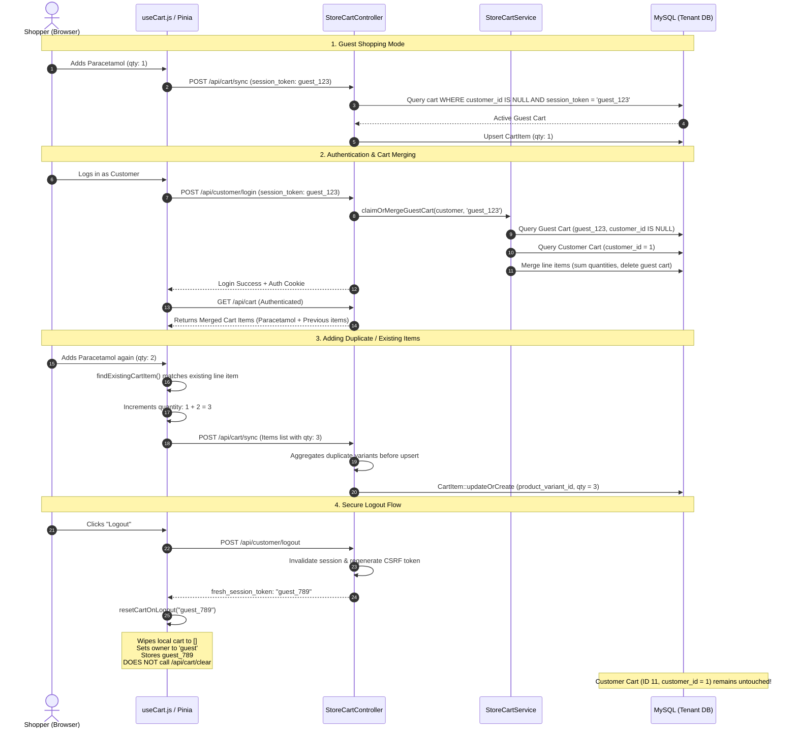

# Storefront Shopping Cart Architecture & Guest/Auth Isolation

## 1. Overview & Health-Tech Privacy Imperative

In a multi-tenant Pharmacy and Health-Tech SaaS application like **Genzilla**, the storefront shopping cart is not merely a generic e-commerce basket—it is sensitive health data. Customers frequently add prescription medications, chronic illness treatments, or personal care items to their cart. 

If cart state leaks across user sessions or persists when a customer logs out on a shared device (such as a family PC or office workstation), sensitive medical information is immediately exposed to the next person using that browser.

To solve this, Genzilla implements an enterprise-grade **Strict Session Isolation & Cart Merging Architecture** inspired by industry benchmarks (Amazon, Shopify, Arogga).

---

## 2. Core Architectural Principles

1. **Authenticated Carts Belong to Customers (`customer_id`)**:
   - An authenticated customer's cart is tied directly to their `customer_id` and `tenant_id` in the database.
   - It **does not rely on a browser cookie or session token** for ownership. Its database record has `session_token = NULL`.
2. **Guest Carts Belong to Session Tokens (`session_token`)**:
   - Unauthenticated shoppers are assigned a unique, random UUID token stored in `localStorage` under `medimart_cart_token` and prefixed with `guest_`.
   - Their database cart record strictly enforces `customer_id = NULL`.
3. **Strict Boundary on Logout**:
   - When a customer logs out, their saved cart remains safely preserved in the database under `customer_id = {id}`.
   - The browser session is destroyed, the CSRF token is regenerated, and a fresh guest session token (`guest_...`) is generated.
   - The browser's active cart state is wiped to `0` items. **No `/api/cart/clear` API call is made**, preventing deletion of the customer's database cart.
4. **Intelligent Merge on Login**:
   - If a guest adds items to their browser cart while logged out, and subsequently logs into their account, the guest cart items are merged into their saved database cart.
   - Identical items/variants have their quantities combined (`existing_qty + guest_qty`).
   - The temporary guest cart record in the database is deleted after merging.
5. **No Cross-Pollination**:
   - A guest cannot access, modify, or delete an authenticated customer's cart by supplying an old or forged `session_token`.
   - Backend queries enforce `whereNull('customer_id')` whenever resolving carts via a `session_token`.

---

## 3. Database Schema Design

The `carts` and `cart_items` tables within the tenant database maintain this isolation through nullable identifiers:

```sql
-- carts table
CREATE TABLE `carts` (
    `id` BIGINT UNSIGNED AUTO_INCREMENT PRIMARY KEY,
    `tenant_id` BIGINT UNSIGNED NOT NULL,
    `customer_id` BIGINT UNSIGNED NULL,
    `session_token` VARCHAR(255) NULL,
    `status` ENUM('active', 'converted', 'abandoned') DEFAULT 'active',
    `recovery_status` ENUM('uncontacted', 'contacted', 'recovered') DEFAULT 'uncontacted',
    `last_activity_at` TIMESTAMP NULL,
    `created_at` TIMESTAMP NULL,
    `updated_at` TIMESTAMP NULL,
    INDEX `carts_tenant_customer_idx` (`tenant_id`, `customer_id`),
    INDEX `carts_tenant_session_idx` (`tenant_id`, `session_token`),
    FOREIGN KEY (`tenant_id`) REFERENCES `tenants` (`id`) ON DELETE CASCADE,
    FOREIGN KEY (`customer_id`) REFERENCES `customers` (`id`) ON DELETE CASCADE
);

-- cart_items table
CREATE TABLE `cart_items` (
    `id` BIGINT UNSIGNED AUTO_INCREMENT PRIMARY KEY,
    `cart_id` BIGINT UNSIGNED NOT NULL,
    `product_id` BIGINT UNSIGNED NOT NULL,
    `product_variant_id` BIGINT UNSIGNED NOT NULL,
    `quantity` INT UNSIGNED NOT NULL DEFAULT 1,
    `created_at` TIMESTAMP NULL,
    `updated_at` TIMESTAMP NULL,
    UNIQUE KEY `cart_items_cart_variant_unique` (`cart_id`, `product_variant_id`),
    FOREIGN KEY (`cart_id`) REFERENCES `carts` (`id`) ON DELETE CASCADE,
    FOREIGN KEY (`product_id`) REFERENCES `products` (`id`) ON DELETE CASCADE,
    FOREIGN KEY (`product_variant_id`) REFERENCES `product_variants` (`id`) ON DELETE CASCADE
);
```

### Key DB States

| Mode | `customer_id` | `session_token` | Notes |
| :--- | :--- | :--- | :--- |
| **Authenticated** | `1` (or user ID) | `NULL` | Owned exclusively by the customer ID. Protected from guest token hijacking. |
| **Guest** | `NULL` | `guest_d4f8e...` | Owned exclusively by the temporary guest UUID token. |

---

## 4. End-to-End Cart Lifecycle



---

## 5. Technical Implementation Details

### 5.1. Backend Service Layer (`StoreCartService.php`)

The [`StoreCartService::claimOrMergeGuestCart`](file:///G:/Projects/genzilla_v3-multitenant-SaaS/app/Services/Store/StoreCartService.php) method handles atomic merging during login:

1. **Strict Guest Query**:
   ```php
   $guestCart = Cart::forCurrentTenant()
       ->whereNull('customer_id')
       ->where('session_token', $sessionToken)
       ->where('status', 'active')
       ->first();
   ```
2. **Isolation & Token Nullification**:
   When obtaining the customer's cart, any residual `session_token` is detached:
   ```php
   $customerCart = Cart::forCurrentTenant()
       ->where('customer_id', $customer->id)
       ->where('status', 'active')
       ->first();

   if ($customerCart && $customerCart->session_token !== null) {
       $customerCart->session_token = null;
       $customerCart->save();
   }
   ```
3. **Quantity Aggregation & Cleanup**:
   - Existing line items sum quantities (`$existingItem->quantity += $guestItem->quantity`).
   - Guest items not yet in customer cart are re-parented (`$guestItem->cart_id = $customerCart->id`).
   - The temporary `$guestCart->delete()` removes empty placeholder records.

### 5.2. Backend Controller Layer (`StoreCartController.php`)

- **Cart Resolution (`resolveCart`)**:
  ```php
  protected function resolveCart(Request $request): Cart
  {
      $customer = $this->resolveCustomer($request);

      if ($customer) {
          $cart = Cart::firstOrCreate(
              [
                  'tenant_id' => tenant('id'),
                  'customer_id' => $customer->id,
                  'status' => 'active',
              ],
              [
                  'last_activity_at' => now(),
              ]
          );

          // Customer carts are tied to customer_id, never to guest session tokens
          if ($cart->session_token !== null) {
              $cart->session_token = null;
              $cart->save();
          }

          return $cart;
      }

      $token = $this->resolveSessionToken($request);
      return Cart::firstOrCreate(
          [
              'tenant_id' => tenant('id'),
              'customer_id' => null,
              'session_token' => $token,
              'status' => 'active',
          ],
          [
              'last_activity_at' => now(),
          ]
      );
  }
  ```

- **Duplicate Variant Aggregation in `syncCart`**:
  Prevents duplicate line items from overwriting each other when hydrated or submitted:
  ```php
  $aggregatedItems = [];
  foreach ($incomingItems as $itemData) {
      $variantId = $itemData['product_variant_id'] ?? $defaultVariant->id;
      if (!isset($aggregatedItems[$variantId])) {
          $aggregatedItems[$variantId] = [
              'product_id' => $product->id,
              'quantity' => $quantity,
          ];
      } else {
          $aggregatedItems[$variantId]['quantity'] += $quantity;
      }
  }

  foreach ($aggregatedItems as $variantId => $data) {
      CartItem::updateOrCreate(
          [
              'cart_id' => $cart->id,
              'product_variant_id' => $variantId,
          ],
          [
              'product_id' => $data['product_id'],
              'quantity' => $data['quantity'],
          ]
      );
  }
  ```

- **Stock & Accessor Safety in `getCart`**:
  `ProductVariant.php` exposes `is_in_stock` as a dynamic Eloquent accessor (`getIsInStockAttribute`), **not** a database column. Direct eager-loading of `is_in_stock` was removed to avoid SQL column not found errors.

### 5.3. Frontend Composable Layer (`useCart.js`)

[`useCart.js`](file:///G:/Projects/genzilla_v3-multitenant-SaaS/resources/js/composables/store/useCart.js) manages client-side cart reactivity, local caching, and synchronization:

1. **Session Ownership Tracking**:
   Stores `medimart_cart_owner` in `localStorage` (`'guest'` vs `'customer_{id}'`).
2. **Safe Logout (`resetCartOnLogout`)**:
   ```javascript
   export function resetCartOnLogout(freshGuestToken = null) {
       if (syncTimer) {
           clearTimeout(syncTimer)
           syncTimer = null
       }
       cart.value = []
       localStorage.removeItem(CART_STORAGE_KEY)
       localStorage.setItem(CART_OWNER_KEY, 'guest')

       if (freshGuestToken) {
           localStorage.setItem(CART_TOKEN_KEY, freshGuestToken)
       } else {
           getCartSessionToken() // generates fresh guest_ token
       }
       // Notice: DOES NOT call clearCart() or /api/cart/clear
   }
   ```
3. **Compound Key Matching (`findExistingCartItem`)**:
   Enables seamless matching whether an item is passed with a compound string ID (`"22-23"`), raw `id: 22`, or explicit `(product_id, variant_id)`:
   ```javascript
   export function findExistingCartItem(item) {
       if (!item) return null
       let existing = cart.value.find((i) => i.id === item.id)
       if (existing) return existing

       const pId = Number(item.product_id) || item.product_id
       const vId = item.variant_id ? (Number(item.variant_id) || item.variant_id) : null

       if (vId) {
           existing = cart.value.find((i) => 
               (Number(i.product_id) || i.product_id) === pId && 
               (Number(i.variant_id) || i.variant_id) === vId
           )
           if (existing) return existing
       }

       return cart.value.find((i) => (Number(i.product_id) || i.product_id) === pId) || null
   }
   ```
4. **Immediate Quantity Incrementing (`addToCart`)**:
   ```javascript
   const existing = findExistingCartItem(item)
   if (existing) {
       existing.qty = Math.min(99, (Number(existing.qty) || 0) + addQty)
   } else {
       item.qty = Math.min(99, addQty)
       cart.value.push(item)
   }
   ```

---

## 6. Security & Isolation Matrix

| Scenario | Expected Behavior | Verification Status |
| :--- | :--- | :---: |
| **Customer Logs Out** | Active cart on screen drops to `0`. Saved cart in database remains tied to `customer_id`. | Passed |
| **Guest Modifies Cart** | Mutation applies only to `session_token` cart (`customer_id = NULL`). Cannot touch customer cart. | Passed |
| **Guest Attempts Token Hijacking** | Requesting `/api/cart` with customer's past token fails to read customer cart (`whereNull('customer_id')`). | Passed |
| **Guest Merges on Login** | Guest items merged into customer cart; duplicate items summed; guest cart record pruned. | Passed |
| **Add Existing Item** | Increments quantity in local reactive state and persists the incremented total to DB. | Passed |

---

## 7. Automated Test Suite

A dedicated feature test suite verifies all cart isolation contracts:

**Test File:** [`tests/Feature/StoreCustomerCartLifecycleTest.php`](file:///G:/Projects/genzilla_v3-multitenant-SaaS/tests/Feature/StoreCustomerCartLifecycleTest.php)

Execute tests via:
```bash
php artisan test tests/Feature/StoreCustomerCartLifecycleTest.php
```

### Verified Test Cases:
1. `authenticated customer cart is saved under customer id with null session token`
2. `adding already present item increments quantity in database`
3. `customer cart remains safely saved in database after logout`
4. `guest actions cannot mutate or clear authenticated customer saved cart`
5. `logging in merges guest cart into authenticated cart and deletes guest cart`
6. `guest cannot access customer cart by passing matching token`
