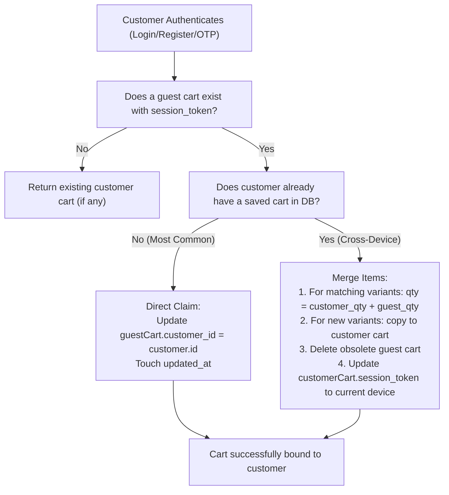

# Storefront Shopping Cart Architecture & Synchronization Specification

## 1. Overview & Business Context

The shopping cart system in **Genzilla v3 Multitenant SaaS (MediMart Storefront)** implements a modern **hybrid architecture**:
- **0ms Reactive Client Experience:** Instant client-side UI responsiveness with zero network latency, persistent across page refreshes via reactive `localStorage`.
- **Database Persistence & Guest-to-Customer Synchronization:** Real-time debounced database synchronization with the backend `carts` and `cart_items` tables.
- **Admin Abandoned Cart Recovery Integration:** Unfinished guest or customer checkouts automatically flow into the admin tele-sales recovery dashboard (`StoreAbandonedCartController`), providing full visibility into lost revenue and customer contact details.

---

## 2. High-Level System Architecture

```mermaid
flowchart TD
    subgraph Client ["Client Browser (Vue 3 Storefront)"]
        UI["ProductCard / ProductDetails / SearchListing"] -->|addToCart()| UC["useCart Composable (Reactive State)"]
        UC -->|0ms Instant Update| CD["CartDrawer.vue & Mobile/Desktop Badges"]
        UC -->|Persist| LS[("localStorage: medimart_cart_v2")]
        UC -->|Debounced 450ms| BGS["syncCartToDatabase()"]
    end

    subgraph Auth ["Authentication Flow"]
        LM["LoginModal.vue"] -->|Pass X-Cart-Session Header| SCAC["StoreCustomerAuthController"]
        SCAC -->|Trigger claimCustomerCart| SCS["StoreCartService"]
    end

    subgraph Backend ["Laravel Backend (Multi-tenant)"]
        BGS -->|POST /api/cart/sync| SCC["StoreCartController"]
        SCC --> SCS
        SCS -->|Transaction| DB_Carts[("carts table (customer_id, session_token)")]
        SCS -->|Transaction| DB_Items[("cart_items table (product_id, variant_id, qty)")]
        DB_Carts -->|Updated >= 2 hrs ago| AC["StoreAbandonedCartController (Tele-Sales Dashboard)"]
    end
```

---

## 3. The "Guest-to-Customer" Cart Claim & Merge Lifecycle

The core convention resolves the problem of shopping carts created by guest visitors before logging in.

### The Problem
When a guest visitor adds products, the database stores the record with `session_token = "guest_..."` and `customer_id = NULL`. If the user subsequently logs in or registers, leaving `customer_id` as `NULL` causes two major issues:
1. The customer's cart does not follow them to other devices (mobile, tablet, work computer).
2. Store tele-sales and support agents in `StoreAbandonedCartController` cannot see the customer's phone number or name to recover the cart.

### Standard Convention Implemented (`StoreCartService::claimOrMergeGuestCart`)

When a user logs in (via password, OTP, or completes registration):



---

## 4. Database Schema & Multi-tenant Scoping

### `carts` Table
```sql
CREATE TABLE carts (
    id BIGINT UNSIGNED AUTO_INCREMENT PRIMARY KEY,
    tenant_id BIGINT UNSIGNED NOT NULL,
    customer_id BIGINT UNSIGNED NULL,
    session_token VARCHAR(100) NULL,
    coupon_id BIGINT UNSIGNED NULL,
    recovery_contacted_at TIMESTAMP NULL,
    recovery_note TEXT NULL,
    created_at TIMESTAMP NULL,
    updated_at TIMESTAMP NULL,
    CONSTRAINT carts_tenant_id_fk FOREIGN KEY (tenant_id) REFERENCES tenants(id) ON DELETE CASCADE,
    CONSTRAINT carts_customer_id_fk FOREIGN KEY (customer_id) REFERENCES customers(id) ON DELETE CASCADE,
    CONSTRAINT carts_coupon_id_fk FOREIGN KEY (coupon_id) REFERENCES coupons(id) ON DELETE SET NULL,
    UNIQUE KEY carts_tenant_session_unique (tenant_id, session_token),
    UNIQUE KEY carts_tenant_customer_unique (tenant_id, customer_id),
    INDEX carts_tenant_updated_idx (tenant_id, updated_at)
);
```

### `cart_items` Table
```sql
CREATE TABLE cart_items (
    id BIGINT UNSIGNED AUTO_INCREMENT PRIMARY KEY,
    cart_id BIGINT UNSIGNED NOT NULL,
    product_id BIGINT UNSIGNED NOT NULL,
    product_variant_id BIGINT UNSIGNED NOT NULL,
    quantity INT UNSIGNED NOT NULL DEFAULT 1,
    created_at TIMESTAMP NULL,
    updated_at TIMESTAMP NULL,
    CONSTRAINT cart_items_cart_id_fk FOREIGN KEY (cart_id) REFERENCES carts(id) ON DELETE CASCADE,
    CONSTRAINT cart_items_product_id_fk FOREIGN KEY (product_id) REFERENCES products(id) ON DELETE CASCADE,
    CONSTRAINT cart_items_product_variant_id_fk FOREIGN KEY (product_variant_id) REFERENCES product_variants(id) ON DELETE CASCADE,
    UNIQUE KEY cart_items_cart_variant_unique (cart_id, product_variant_id),
    INDEX cart_items_cart_product_idx (cart_id, product_id)
);
```

---

## 5. API Endpoints

All storefront cart endpoints are mounted inside the tenant middleware group:
`['web', 'tenant.identify', 'store.status']`.

| HTTP Verb | Path | Controller Action | Description |
|---|---|---|---|
| `GET` | `/api/cart` | `StoreCartController@getCart` | Retrieves current cart formatted with item details, variant title, image, pricing, and prescription indicators. |
| `POST` | `/api/cart/sync` | `StoreCartController@syncCart` | Synchronizes array of line items from client state with DB in a single database transaction. |
| `POST` | `/api/cart/clear` | `StoreCartController@clearCart` | Empties all items from the active cart record in the database. |

### Payload Example: `POST /api/cart/sync`
```json
{
    "session_token": "guest_qlulqkercemwd4hzt9",
    "items": [
        {
            "product_id": 1,
            "variant_id": 1,
            "quantity": 2,
            "price": 19.99
        },
        {
            "product_id": 4,
            "variant_id": 6,
            "quantity": 1,
            "price": 120.00
        }
    ]
}
```

### Response Example:
```json
{
    "success": true,
    "cart_id": 12,
    "session_token": "guest_qlulqkercemwd4hzt9",
    "count": 3,
    "subtotal": 159.98,
    "has_prescription_items": false
}
```

---

## 6. Frontend Composable Specification (`useCart.js`)

### Reactive State & Singletons
- `cart`: Reactive `ref` containing the array of normalized cart items.
- `cartCount`: Computed total quantity of items.
- `cartSubtotal`: Computed selling price sum.
- `cartMrp`: Computed original MRP sum.
- `cartDiscount`: Instant savings amount (`cartMrp - cartSubtotal`).
- `freeDeliveryRemaining`: Amount needed to reach `FREE_DELIVERY_THRESHOLD` (৳500).
- `freeDeliveryPct`: Percentage (0–100%) for the free delivery progress bar.
- `hasPrescriptionItems`: Boolean flag indicating if any cart item requires a doctor prescription (`requires_prescription: true`).
- `isCartSyncing`: Boolean flag showing real-time background synchronization activity.

### Core Functions
- `addToCart(product, quantity, options)`: Normalizes product, handles variant uniqueness, updates local storage, triggers toast, and schedules DB sync.
- `changeQty(id, delta)`: Increments/decrements quantity. Auto-removes item if quantity reaches 0.
- `removeItem(id)`: Removes line item completely and saves.
- `clearCart()`: Clears reactive state, local storage, and invokes `POST /api/cart/clear`.
- `syncCartToDatabase()`: 450ms debounced Axios call to `/api/cart/sync` with `X-Cart-Session` header.
- `hydrateCartFromDatabase()`: On initial page mount, checks if DB has items when local storage is empty, seamlessly restoring user cart across devices.

---

## 7. Tele-Sales & Abandoned Cart Recovery Integration

Every cart synchronized to the database becomes actionable in the store admin dashboard:
- **Abandoned Criteria:** Any cart where `updated_at <= now()->subHours(2)` and `items_count > 0`.
- **Recoverable Queue:** Carts where `customer_id IS NOT NULL` allow customer support to view customer name, phone number, and items to place outbound phone calls or send WhatsApp recovery offers.
- **Lost Revenue Analytics:** The system tallies both recoverable revenue (known customer carts) and total lost catalog revenue (including unauthenticated guests).
