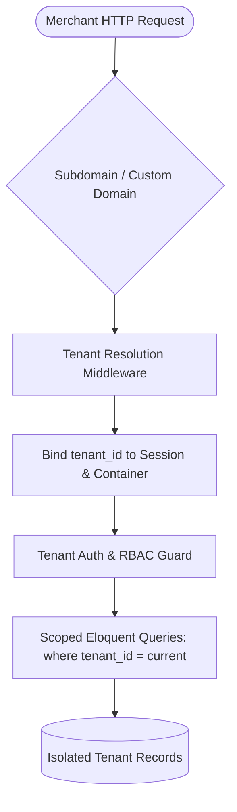
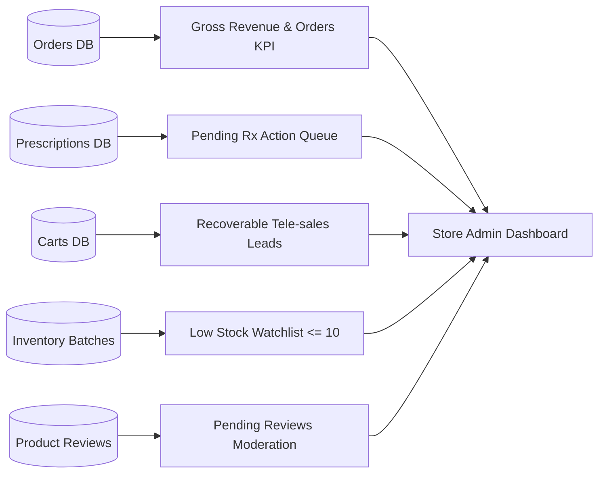
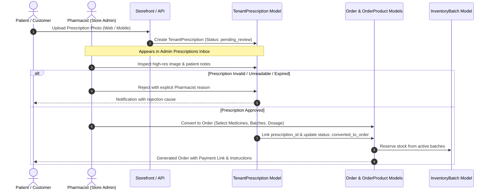
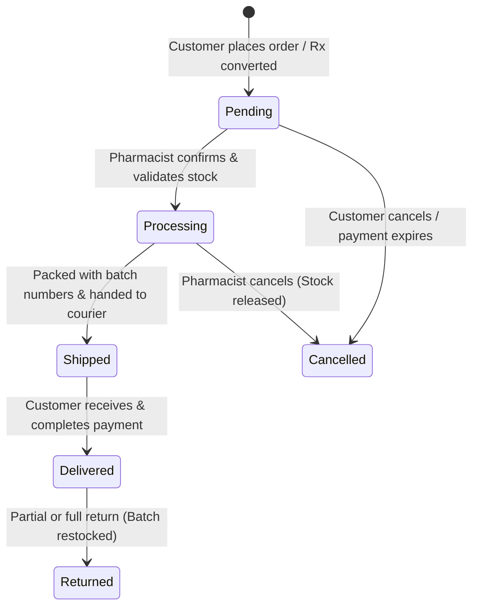
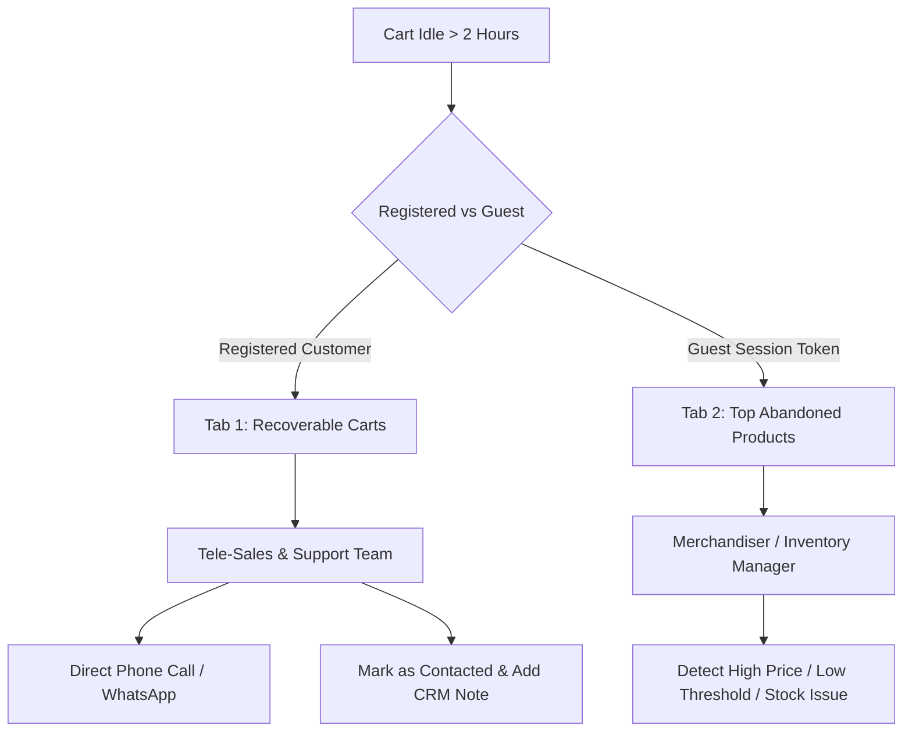
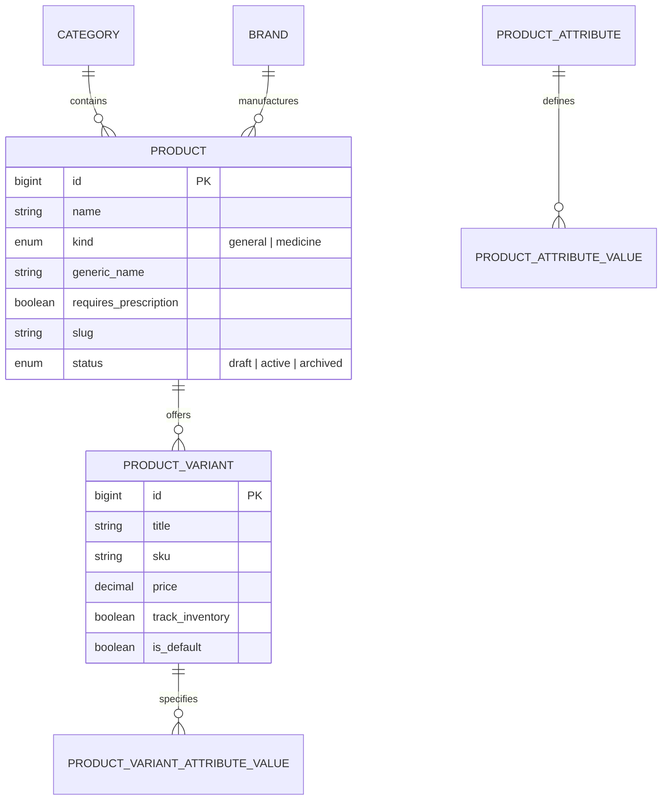
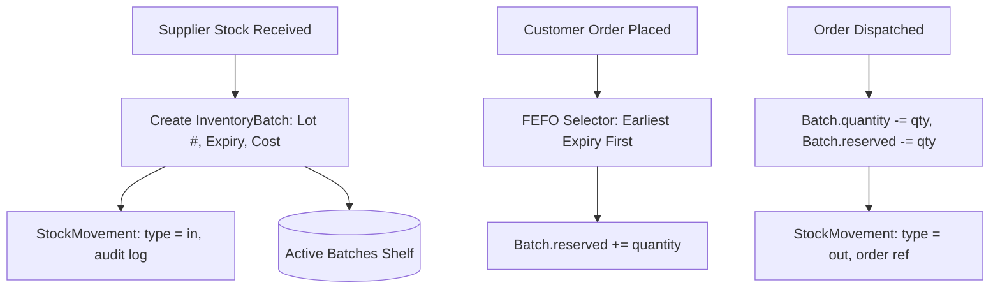
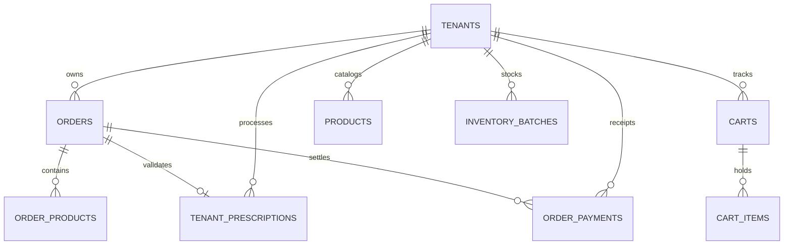

# Genzilla Multi-Tenant SaaS — Store Admin Feature Documentation

**System Version:** v3.0  
**Target Domain:** Health-Tech, Pharmacy & Specialized Retail SaaS  
**Document Generation Date:** November 2026  
**Status:** Production Ready / Initial Store Admin Complete  

---

## Table of Contents

1. [Executive Summary & Architectural Philosophy](#1-executive-summary--architectural-philosophy)
2. [Multi-Tenancy & Data Isolation Model](#2-multi-tenancy--data-isolation-model)
3. [Security, Authentication & Role-Based Access Control (RBAC)](#3-security-authentication--role-based-access-control-rbac)
4. [Store Admin Dashboard & Real-Time Analytics](#4-store-admin-dashboard--real-time-analytics)
5. [Prescription Management & Tele-Pharmacy Workflow](#5-prescription-management--tele-pharmacy-workflow)
6. [Order Management, Checkout & Invoicing Pipeline](#6-order-management-checkout--invoicing-pipeline)
7. [Abandoned Checkouts & Recoverable Carts System](#7-abandoned-checkouts--recoverable-carts-system)
8. [Transactions & Financial Payment Ledger](#8-transactions--financial-payment-ledger)
9. [Product Catalog & Specification Architecture](#9-product-catalog--specification-architecture)
10. [FEFO Batch Inventory & Double-Entry Stock Movement Ledger](#10-fefo-batch-inventory--double-entry-stock-movement-ledger)
11. [Product Reviews & Customer Reputation System](#11-product-reviews--customer-reputation-system)
12. [Customer Relationship Management (CRM) & Directory](#12-customer-relationship-management-crm--directory)
13. [Promotions, Dynamic Coupons & Delivery Charges](#13-promotions-dynamic-coupons--delivery-charges)
14. [Storefront & Content Management (CMS)](#14-storefront--content-management-cms)
15. [Store Settings, Custom Domains & SaaS Subscription](#15-store-settings-custom-domains--saas-subscription)
16. [Business Intelligence & Reporting Suite](#16-business-intelligence--reporting-suite)
17. [Database Schema & Architecture Cross-Reference](#17-database-schema--architecture-cross-reference)

---

## 1. Executive Summary & Architectural Philosophy

The **Store Admin Workspace** in the Genzilla v3 SaaS platform serves as the central operational cockpit for individual pharmacy merchants, pharmacists, inventory managers, and customer support representatives. 

While generic e-commerce platforms treat medicines like arbitrary physical retail items, the Genzilla Store Admin architecture has been tailor-engineered to resolve the specific operational, regulatory, and logistical realities of the pharmacy industry:

* **Strict Legal Compliance:** Safeguarding prescription-only drugs through a verifiable upload, review, and pharmacist sign-off pipeline prior to dispatch.
* **Batch-Level Traceability (FEFO):** Enforcing lot number assignment, batch-specific expiration tracking, and First-Expired, First-Out (FEFO) dispensing logic.
* **Tele-Sales & Prescription Recovery:** Bridging the gap between patient cart abandonment (due to missing prescriptions or sizing confusion) and tele-sales outreach via WhatsApp/Phone.
* **Double-Entry Financial & Inventory Ledgers:** Eliminating untracked inventory drift and reconciliation discrepancies across multiple payment channels (bKash, Nagad, Rocket, COD, Card).
* **Multi-Tenant Autonomous Workspaces:** Providing every merchant with an isolated administration portal, custom branding, localized pricing, custom domain mappings, and independent staff role permissions.

---

## 2. Multi-Tenancy & Data Isolation Model

Every tenant operates within a shared database infrastructure utilizing **Tenant-Aware Scoping** with strict row-level security and software-enforced boundary validation.

### 2.1 Core Multi-Tenancy Invariants

1. **Compound Unique Constraints:** All natural keys (SKU, Slugs, Coupon Codes, Prescription Numbers, Order Numbers) enforce uniqueness at the `['tenant_id', 'column']` level rather than globally.
2. **Container & Session Isolation:** The tenant context is resolved through the `auth.tenant` middleware pipeline. The active tenant identifier is made globally accessible to models, policies, and controllers via the `tenantId()` helper function.
3. **Foreign Key Integrity:** All operational tables (`orders`, `products`, `product_variants`, `inventory_batches`, `tenant_prescriptions`, `carts`, `order_payments`, `customers`) maintain a mandatory cascading foreign key referencing `tenants.id`.
4. **Tenant-Safe User Relationships:** Platform users who act as store administrators or pharmacy staff are scoped to their respective tenant via Spatie Permission `team_id` / `tenant_id` bindings.

---

## 3. Security, Authentication & Role-Based Access Control (RBAC)

The Store Admin security subsystem provides granular access delegation through Spatie Laravel-Permission, partitioned by tenant.

### 3.1 Architecture & Guard Isolation

* **Guard:** `web` guard scoped with `PermissionRegistrar::setPermissionsTeamId($tenantId)`.
* **Super Tenant Account (`Store Owner`):** The creator of the pharmacy tenant. Protected against accidental status toggles or account deletion.
* **Staff Management:** Store owners can invite and provision multiple staff accounts (Pharmacist, Order Dispatcher, Tele-Sales Rep, Content Moderator) with fine-grained privileges.

### 3.2 Permission Matrix

| Permission Group | Permission Name | Typical Assigned Roles | Description |
| :--- | :--- | :--- | :--- |
| **Dashboard** | `Store Dashboard` | Owner, Pharmacist, Staff | Access to operational summary and analytics |
| **Prescriptions** | `Store Prescription List` | Owner, Pharmacist | View incoming patient Rx uploads |
| | `Store Prescription View` | Owner, Pharmacist | Inspect high-res Rx images and patient notes |
| | `Store Prescription Convert` | Owner, Pharmacist | Transform Rx into billable order with dosage |
| | `Store Prescription Reject` | Owner, Pharmacist | Reject invalid/expired prescription with reason |
| | `Store Prescription Delete` | Owner | Purge prescription records |
| **Orders** | `Store Order List` | Owner, Pharmacist, Dispatcher | View order listing and status filters |
| | `Store Order Create` | Owner, Sales Rep | Create manual walk-in or phone orders |
| | `Store Order View` | Owner, Pharmacist, Dispatcher | Inspect customer details, items, invoice |
| | `Store Order Edit` | Owner, Pharmacist | Update order status, payment status, Rx review |
| | `Store Order Delete` | Owner | Soft delete cancelled orders |
| **Abandoned Carts** | `Store Abandoned Checkout List` | Owner, Sales Rep | View actionable recoverable carts & analytics |
| | `Store Abandoned Checkout Contact` | Owner, Sales Rep | Update follow-up notes & mark contacted |
| **Catalog** | `Store Product List / Create / Edit / Delete` | Owner, Inventory Manager | CRUD operations on medicines & retail goods |
| | `Store Category / Brand / Attribute` | Owner, Inventory Manager | Taxonomy and variant attribute matrix control |
| **Inventory** | `Store Inventory List` | Owner, Inventory Manager, Pharmacist | View stock on hand, reserved stock, batches |
| | `Store Inventory Manage` | Owner, Inventory Manager | Receive new batches, adjust quantities/expiry |
| **Transactions** | `Store Transaction List / Create / Refund / Export` | Owner, Accountant | Audit payments, log cash receipts, process refunds |
| **Reviews** | `Store Product Review List / Approve / Reply / Delete` | Owner, Support Staff | Moderate user feedback and post official replies |
| **Reports** | `Store Report List / Export` | Owner, Accountant | Access business intelligence and export CSV/PDF |
| **Security & Settings** | `Store Admin List / Role List / General Setting` | Owner only | Account provisioning, role definition, store config |

---

## 4. Store Admin Dashboard & Real-Time Analytics

The Dashboard (`/store/dashboard`) delivers a responsive, high-density command center aggregating key performance indicators across the entire pharmacy operation.

### 4.1 Key Dashboard Metrics & Live Widgets

1. **Operational KPI Summary Cards:**
   * **Gross Sales (৳):** Net valid order revenue (excluding cancelled orders) with daily incremental comparison (`+৳ X today`).
   * **Total Orders:** Lifetime volume of storefront and manual orders, broken down by today's intake and pending queue.
   * **Rx Pending Review:** Real-time badge tracking prescription uploads awaiting pharmacist validation.
   * **Recoverable Carts:** Count of registered customers who abandoned populated carts > 2 hours ago and have not yet been contacted.
2. **Interactive 14-Day Dual-Axis Trends Chart:**
   * Line plot displaying daily revenue turnover (in BDT).
   * Bar overlay tracking daily order counts with hover tooltips and dynamic k-abbreviations.
3. **Distribution Breakdown Card:**
   * **Payment Preference:** Doughnut visualization of orders by gateway (bKash, Nagad, Rocket, COD, Card).
   * **Fulfillment Pipeline:** Segmented status distribution (Delivered, Processing, Pending, Shipped, Cancelled).
4. **Actionable Operational Feeds:**
   * **Recent Orders:** Real-time table displaying order number, customer name, total, status badges, and direct links.
   * **Prescriptions Inbox:** Visual queue showing patient thumbnail, upload timestamp, and quick-process action.
   * **Critical Low-Stock Watchlist:** Inventory items with `available_stock <= 10 units` indicating SKU, available vs. reserved units, and reorder warnings.
   * **Review Moderation Feed:** Recent ratings and customer comments awaiting public approval.

---

## 5. Prescription Management & Tele-Pharmacy Workflow

Prescription handling is the cornerstone of regulatory compliance in digital pharmacy operations. The Genzilla architecture separates general health merchandise from prescription-required medicines (`requires_prescription = true`).

### 5.1 Prescription Workspace Features

* **High-Resolution Inspection:** Zoomable preview of doctor prescriptions, handwritten notes, and hospital discharge summaries.
* **Patient Context:** Direct access to customer name, telephone, delivery address, and previous medication requests.
* **Interactive Order Conversion Engine:**
  * Real-time search across store medicine catalog.
  * Batch selection with live expiry dates and available stock indicators.
  * Dosage instruction builder (e.g. `1 tablet morning and night after food for 7 days`).
  * Automatic subtotal calculation, delivery charge assignment, and discount application.
* **Audit Trail:** Captures `reviewed_by_user_id`, `reviewed_at`, and permanent conversion status.

---

## 6. Order Management, Checkout & Invoicing Pipeline

The order processing engine supports both storefront customer checkouts and manual phone/walk-in orders placed by store staff.

### 6.1 Order Status Lifecycle

### 6.2 Key Features in Order Workspace

* **Rx Pharmacist Verification Gate:** Any order containing medicines marked `requires_prescription = true` displays an alert banner until a licensed pharmacist clicks "Review & Approve".
* **Batch-Deducted Order Items:** Order lines store exact `product_variant_id`, SKU, unit selling price, quantity, and batch allocation.
* **Payment State Synchronization:** Tracks payment status (`unpaid`, `partially_paid`, `paid`, `refunded`, `failed`) independently of fulfillment status.
* **Printable Invoices:** Formatted receipt generator containing store tax info, pharmacy license number, itemized pricing, batch numbers, dosage notes, and customer delivery details.

---

## 7. Abandoned Checkouts & Recoverable Carts System

Online pharmacies experience significant cart abandonment when customers lack an immediate prescription photo or need assistance with strip versus pack quantities. The Genzilla Recoverable Carts system transforms lost traffic into tele-sales leads.

### 7.1 Recoverable Carts vs. Catalog Analytics

| Feature Dimension | Recoverable Carts (Tab 1) | Top Abandoned Products (Tab 2) |
| :--- | :--- | :--- |
| **Primary Goal** | Direct sales recovery via personalized patient support | Catalog friction analytics & merchandising optimization |
| **Target Audience** | Registered accounts (`customer_id IS NOT NULL`) | All traffic (Guests via `session_token` + registered) |
| **Granularity** | One row per Customer / Cart | One row per Product Variant |
| **Key Metrics** | Customer Name, Phone, Cart Value, Idle Time, Rx Flag | Abandoned Count, Stuck Quantity, Lost Potential Revenue |
| **Staff Action** | Call customer, request Rx via WhatsApp, send coupon | Adjust variant price, lower delivery threshold |
| **Audit Tracking** | `recovery_contacted_at` timestamp + `recovery_note` | Aggregated abandonment frequency |

---

## 8. Transactions & Financial Payment Ledger

The Store Admin Transactions module (`/store/transactions`) serves as a double-entry payment ledger that reconciles digital gateway transactions, offline bank transfers, and Cash on Delivery (COD).

### 8.1 Transaction Ledger Schema & Methods

* **Tracked Gateways:** bKash, Nagad, Rocket, SSLCommerz, Cash on Delivery (COD), Manual Bank Transfer.
* **Status Model:** `pending`, `successful`, `failed`, `refunded`.
* **Manual Payment Logging:** Store staff can record manual customer deposits against open orders with transaction references and notes.
* **Refund Engine:** Integrated refund workflow supporting partial and full refunds with mandatory audit justifications (`order_payments.status = 'refunded'`).
* **Export Capability:** Filtered CSV download of transaction ledgers for accounting and external book-keeping.

---

## 9. Product Catalog & Specification Architecture

The Catalog subsystem manages the pharmacy's product master records across standard health goods and regulated medicines.

### 9.1 Catalog Highlights

* **Medicine Classification:** Supports generic active ingredient names (`generic_name`), drug dosage types (Syrup, Tablet, Capsule, Injection, Inhaler), and regulatory prescription flags.
* **Variant Matrix:** Dynamic attribute generation (e.g. Size: `10s Strip`, `100s Box`, Volume: `100ml`, `200ml`).
* **SEO Metadata:** Automated and manual slug management, meta titles, descriptions, and structured product data for search engines.
* **AVIF/WebP Optimized Media:** Built-in thumbnail and gallery management with image optimization.

---

## 10. FEFO Batch Inventory & Double-Entry Stock Movement Ledger

Pharmacy inventory cannot be managed as a simple flat numerical count. Compliance demands tracking distinct manufactured lots, manufacturer expiry dates, and lot-specific purchase costs.

### 10.1 Inventory Mechanics

1. **Batch Allocation (`InventoryBatch`):**
   * Stores `batch_number`, `expiry_date`, unit `cost_price`, `quantity`, and `reserved`.
   * Only batches with status `active` and unexpired dates are eligible for automated order fulfillment.
2. **First-Expired, First-Out (FEFO):**
   * System prioritizes depleting batches with the closest expiration date to minimize obsolete medicine write-offs.
3. **Immutable Stock Movement Audit (`StockMovement`):**
   * Records every transaction (`in`, `out`, `adjustment`, `reserved`, `released`).
   * Tags the user (`user_id`), related variant, batch, timestamp, and optional note.
4. **Stock Reservation Engine:**
   * When an order is placed, units transition to `reserved` to avoid overselling during peak traffic.
   * If an order is cancelled, reserved units are automatically released back to available inventory.

---

## 11. Product Reviews & Customer Reputation System

The Product Reviews workspace (`/store/catalog/reviews`) provides store owners with full editorial control over storefront patient ratings and testimonials.

### 11.1 Review Workflow & Moderation

* **Moderation States:** `pending` (default for new submissions), `approved` (visible on storefront), `rejected` (hidden).
* **Star Ratings & KPIs:** Tracks average store rating, rating breakdown (1 to 5 stars), and total review volume.
* **Merchant Replies:** Store pharmacists and customer service reps can post verified official responses displayed underneath customer reviews.
* **Bulk Moderation:** One-click bulk approval and rejection actions for rapid queue processing.

---

## 12. Customer Relationship Management (CRM) & Directory

The Customer module (`/store/customers`) maintains patient and shopper profiles across digital checkout channels.

### 12.1 CRM Capabilities

* **Profile & Contact Summary:** Complete name, email, primary phone, account verification status, and registration date.
* **Lifetime Value (LTV) Metrics:** Aggregates total completed orders, gross spent turnover, and last order date.
* **Multi-Address Book:** Manages patient home, office, and hospital delivery addresses with default flags.
* **Status Governance:** Instant account status toggle (`active`, `suspended`, `inactive`) to mitigate fraud or bad-debt accounts.

---

## 13. Promotions, Dynamic Coupons & Delivery Charges

The promotions engine allows merchants to drive customer acquisition while maintaining gross margin thresholds.

### 13.1 Coupon Engine Features

* **Discount Mechanics:** Supports both Percentage (`%`) and Fixed Amount (`৳`) discounts.
* **Cart Thresholds:** Minimum spend limits (e.g. `10% off on orders above ৳ 1,500`).
* **Usage Quotas:** Max total usage limits and per-customer usage constraints.
* **Validity Windows:** Start and expiry date-time gating.

### 13.2 Geo-Targeted Delivery Charges

* **Tiered Logistics:** Flat rate configurations by zone (Inside Dhaka: ৳ 60, Outside Dhaka: ৳ 120, Express 2-Hour Delivery: ৳ 150).
* **Free Delivery Thresholds:** Automatically waives delivery fees when cart subtotal reaches designated limits.

---

## 14. Storefront & Content Management (CMS)

Store administrators can manage customer-facing storefront visual assets and legal documents directly from the admin panel without code modifications.

* **Hero Sliders (`/store/content/sliders`):** Image banners, headline typography, sub-headings, CTA link targets, and custom sorting orders.
* **Promo Banners (`/store/content/banners`):** Promotional graphic cards mapped to homepage grid positions (Top, Middle, Sidebar, Footer).
* **Custom Pages (`/store/content/pages`):** Rich-text legal and informational pages (Privacy Policy, Terms of Service, Return & Refund Policy, About Us, Medicine Return Guidelines).

---

## 15. Store Settings, Custom Domains & SaaS Subscription

The configuration section gives pharmacy owners complete autonomy over their digital identity, financial gateways, and platform subscription.

### 15.1 Store Settings (`/store/settings`)
* **Identity:** Pharmacy name, hotline phone number, support email, physical store address, and license/drug administration registration numbers.
* **Compliance Controls:** Prescription enforcement toggles (Mandatory Rx Mode vs. Warning Mode).

### 15.2 Custom Domains & DNS (`/store/domains`)
* **Dual Routing:** Access via default subdomain (`tenant.genzilla.com`) or white-label custom domain (`pharmacy.com`).
* **DNS Verification:** Self-service CNAME and A-record verification workflow.

### 15.3 Payment Gateways (`/store/payments/methods`)
* Direct API credential setup for local mobile financial services (bKash Merchant API, Nagad Gateway, SSLCommerz, and COD toggle).

### 15.4 Subscription & Quotas (`/store/subscription`)
* Subscription plan tier visibility (Starter, Growth, Enterprise).
* Live quota utilization (Product count, monthly order quota, storage limits).
* Invoice receipts download and subscription plan upgrade/cancellation controls.

---

## 16. Business Intelligence & Reporting Suite

The reporting subsystem (`/store/reports`) provides analytical business intelligence reports designed for pharmacy accounting, supplier restocking, and operational audits.

### 16.1 Supported Report Types

1. **Sales Performance Report:** Daily and monthly gross sales, discounts given, delivery fees collected, and net revenue.
2. **Inventory Valuation & Expiry Report:** Total inventory capital locked in warehouse batches, batch count, and medicines expiring within 30, 60, or 90 days.
3. **Order Fulfillment Performance:** Volume of orders delivered on time, average fulfillment duration, cancellation rate, and return reasons.
4. **Customer Acquisition & LTV:** New patient signups, repeat customer order ratios, and top customers by revenue.

### 16.2 Export Capabilities
* **CSV / Excel:** High-speed data export formatted for spreadsheet accounting.
* **Formatted PDF:** A4 landscape executive summaries generated via DomPDF with branded store headers, summary KPI callouts, and clean data tables.

---

## 17. Database Schema & Architecture Cross-Reference

### 17.1 Core Tenant Schema Map

### 17.2 Primary Model Directory

* **Orders & Sales:**
  * `App\Models\Order` — Root customer order record with tax, shipping, and fulfillment flags.
  * `App\Models\OrderProduct` — Line items storing historical unit prices and batch links.
  * `App\Models\OrderPayment` — Transaction ledger logs per payment attempt.
* **Prescriptions:**
  * `App\Models\TenantPrescription` — Direct prescription uploads, images, and pharmacist notes.
* **Abandoned Carts:**
  * `App\Models\Cart` — Customer and guest shopping carts with follow-up metadata.
  * `App\Models\CartItem` — Cart items holding quantities and variant links.
* **Catalog & Stock:**
  * `App\Models\Product` — Core catalog definitions and regulatory flags.
  * `App\Models\ProductVariant` — Specific pack/strip sizes and SKUs.
  * `App\Models\InventoryBatch` — Lot-specific physical inventory, quantities, and expiration dates.
  * `App\Models\StockMovement` — Tamper-proof double-entry inventory audit log.
* **Store Configuration:**
  * `App\Models\Tenant` — Multi-tenant organization and store preferences.
  * `App\Models\StoreDomain` — Custom DNS mappings and verification statuses.
  * `App\Models\User` — Tenant administrators and staff members.

---

## 18. Conclusion & Operational Readiness

The Store Admin module of Genzilla v3 is fully realized, fully tested, and ready for production operations. By combining pharmacy-specific workflows (FEFO batches, Rx conversions, tele-sales recovery) with modern multi-tenant cloud architecture, the platform equips independent and chain pharmacies to run an efficient, compliant, and scalable digital retail operation.
